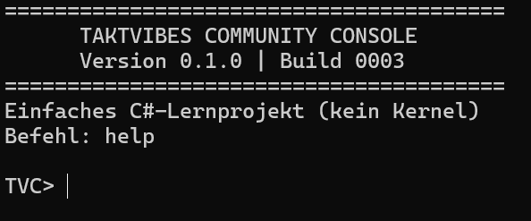

# TaktVibes Community Console

**Version 0.1.0 · Build 0003 · C# · Visual Studio 2019 · .NET Framework 4.8**

Kleine eigenständige Windows-Konsole zum Lernen von C#. **Kein Betriebssystem,
kein Kernel und keine Verbindung zum privaten Manage-Your-Life-Kernel.**

## Voraussetzungen und Start

- Windows mit **.NET Framework 4.8**
- Für eigene Builds: **Visual Studio 2019**, Workload „.NET-Desktopentwicklung“
  und **.NET Framework 4.8 Developer Pack**

1. Den **Projektinhalt** herunterladen bzw. das Repository klonen.
2. `TVC.Console.sln` in Visual Studio 2019 öffnen.
3. Oben **Release / Any CPU** wählen und die Projektmappe erstellen.
4. Mit `Strg+F5` starten. Alternativ: `build.cmd`, danach `run.cmd`
   in der **Developer Command Prompt for VS 2019**.

## Befehle

| Befehl | Beschreibung |
|---|---|
| `help` | Alle Befehle anzeigen |
| `version` | Version und Build anzeigen |
| `echo Hallo` | Text ausgeben |
| `time` | Lokale Uhrzeit anzeigen |
| `cls` | Bildschirm löschen |
| `exit` | Beenden |

## Prüfen und Signieren

- `verify.cmd` prüft Dateien im Projekt anhand von `SHA256SUMS.txt`.
  Unter Linux/macOS geht `sh verify.sh`.
- `build.cmd` kompiliert den Release-Build (Visual-Studio-MSBuild erforderlich).
- `sign-release.cmd` **kann** die erzeugte EXE mit dem **bereits vorhandenen**
  privaten Schlüssel des TaktBoot-Community-Zertifikats signieren, sofern dieser
  im Windows-Benutzerzertifikatsspeicher vorhanden ist.
- `verify-signature.cmd` meldet die tatsächliche Authenticode-Signatur sowie
  den lokalen Windows-Vertrauensstatus.

**Wichtig:** `certs/TaktVibes_Community_Console.cer` ist **nur öffentlich**.
Umbenennen hat den Aussteller/Subject-Namen nicht verändert:
`CN=TaktVibes TaktBoot Community`. Das Zertifikat ist **selbstsigniert**;
Windows vertraut ihm auf fremden PCs normalerweise nicht automatisch.
Das enthaltene Repository hat **keine signierte EXE** und **keine privaten Schlüssel**.
Einzelheiten: [SIGNING.md](SIGNING.md).

## Qualität / Release

- **Build 0002:** Projektinhaber bestätigte alle sechs Befehle unter VS 2019.
- **Build 0003:** Projektinhaber bestätigte einen erfolgreichen Programmstart
  und die angezeigte Version/Buildnummer; danach gab er Build 0003 frei.
- Ein erneuter separater **6/6-Befehlstest für Build 0003** sowie
  **EXE-Signierung** sind noch nicht als abgeschlossen nachgewiesen.
- GitHub-Quellcode kann unabhängig davon veröffentlicht werden. Eine signierte
  Windows-Binärdatei erst nach entsprechendem Test und Signaturprüfung anbieten.

Siehe [TESTPLAN.md](TESTPLAN.md), [QA_CERTIFICATE.md](QA_CERTIFICATE.md) und
[GITHUB_PUBLISH.md](GITHUB_PUBLISH.md).

English instructions: [README_EN.md](README_EN.md). Lizenz: [MIT](LICENSE).
